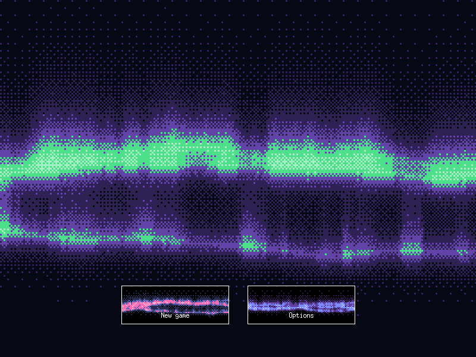
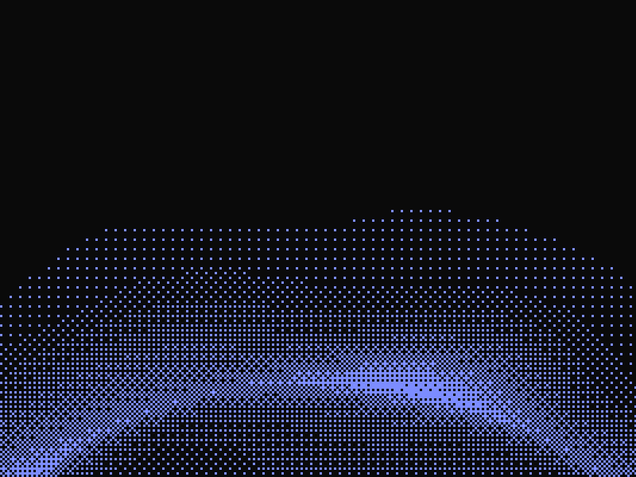
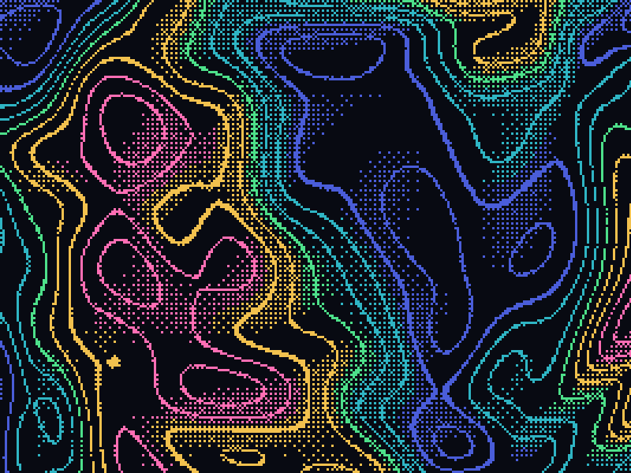
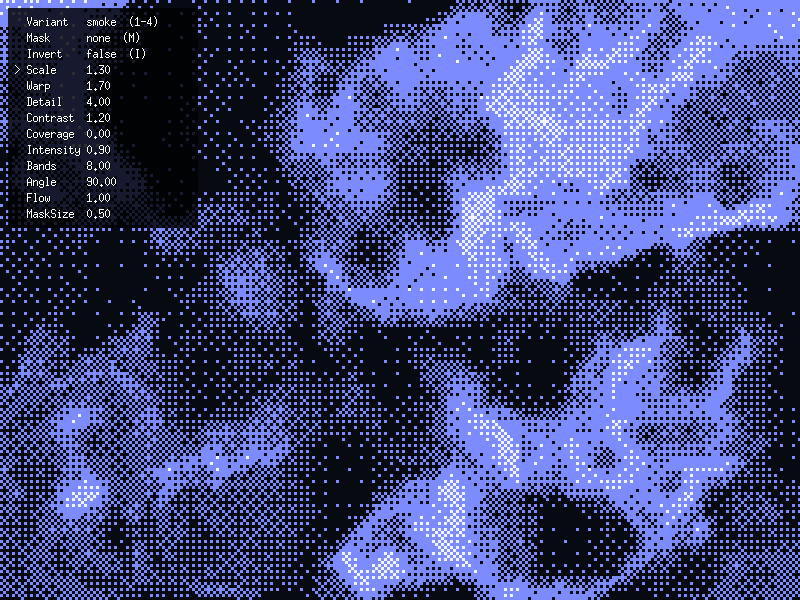

# dithergo

Dithered graphics for [Ebitengine](https://ebitengine.org): turn any image into ordered (Bayer) dither dots, or draw a ready-made animated dithered background. Inspired by [dithercn](https://dithercn.dev).



## Install

```sh
go get github.com/dwethmar/dithergo
```

Needs Ebitengine v2.10 or newer.

## Dither an image

Draw anything bright-on-dark into an image: a frame of the game, a sprite, a gradient from a shader of your own. `Draw` turns its brightness into dots. Black stays paper, white is solid ink, and the tones between are dots at a matching density.

```go
dithergo.Draw(screen, picture, &dithergo.Options{
    Ink:   color.RGBA{0x7c, 0x8c, 0xff, 0xff},
    Paper: color.RGBA{0x0a, 0x0a, 0x0a, 0xff},
})
```



## Backgrounds

All take a size and a clock in seconds that keeps running. Multiply the clock to speed one up or slow it down.

```go
// Northern lights. AuroraPalette makes the two-colour look.
dithergo.Aurora(screen, w, h, seconds, &dithergo.Options{
    Palette: dithergo.AuroraPalette(night, violet, green), // sky, ray tips, bright edges
})

// A topographic map whose hills morph like a lava lamp. One colour per height.
dithergo.Contours(screen, w, h, seconds, &dithergo.Options{
    Palette: []color.Color{night, blue, teal, green, amber, pink}, // paper, then valleys to peaks
})
```



## Noise field

`NoiseField` is the background with controls: slowly folding noise in four styles, after [dithercn's noise field](https://dithercn.dev/docs/backgrounds/noise-field). Start from `DefaultNoise` and change what you need.

```go
noise := dithergo.DefaultNoise()
noise.Variant = dithergo.NoiseMarble
noise.Warp = 2.4
noise.Bands = 5
noise.Mask = dithergo.MaskBottom // keep the bottom clear for text

dithergo.NoiseField(screen, w, h, seconds, &noise, &dithergo.Options{
    Matrix:  dithergo.Bayer8,
    Palette: []color.Color{night, blue, white}, // paper, ink, highlight on the brightest peaks
})
```

Passing `nil` for the noise gives `DefaultNoise`. The zero value `dithergo.Noise{}` is not a useful field, so always start from `DefaultNoise`.



| Field       | Default      | What it does                                                                                  |
| ----------- | ------------ | --------------------------------------------------------------------------------------------- |
| `Variant`   | `NoiseSmoke` | The style, see below.                                                                         |
| `Scale`     | `1.3`        | Size of the features. Higher values give smaller, busier noise.                               |
| `Warp`      | `1.7`        | How far the noise folds back on itself, from 0 (plain noise) to about 4.                      |
| `Detail`    | `4`          | Layers of noise, from 1 (smooth blobs) to 6 (fine grain on top).                              |
| `Contrast`  | `1.2`        | 1 is soft, 2 and up give hard-edged islands. Has no effect on `NoiseContours`.                |
| `Coverage`  | `0`          | How much of the rectangle is inked, from -0.5 (sparse) to 0.5 (dense).                        |
| `Intensity` | `0.9`        | The brightest tone it reaches, from 0 to 1.                                                   |
| `Invert`    | `false`      | Swaps paper and ink.                                                                          |
| `Bands`     | `8`          | Lines for `NoiseContours`, stripes for `NoiseMarble`, from 2 to 24.                           |
| `Angle`     | `90`         | The direction it drifts in, in degrees. 0 is right, 90 is up.                                 |
| `Flow`      | `1`          | How fast it drifts that way, from 0 (it only folds in place) to about 4.                      |
| `Mask`      | `MaskNone`   | Fades it to paper where text sits: `MaskCenter`, `MaskTop`, `MaskBottom`, `MaskEdges`.        |
| `MaskSize`  | `0.5`        | How much of the rectangle the mask clears, from 0 to 1.                                       |

The variants:

- `NoiseSmoke`: soft folds that dither into smooth gradients.
- `NoiseRidges`: sharp creases, like veins or lightning.
- `NoiseContours`: topographic lines, spaced by `Bands`. For a cleaner map with a colour per height, use `Contours`.
- `NoiseMarble`: warped stripes, also set by `Bands`.

Numbers outside a range are brought back into it. The colours, dot size and dot pattern come from `Options`, like everywhere else: the tone runs along the palette, so a third colour lands on the brightest peaks.

To find a look, run the example and turn the controls with the keyboard, then copy the numbers it shows:

```sh
go run ./example/noisefield
```

| Key           | What it does                              |
| ------------- | ----------------------------------------- |
| `1` `2` `3` `4` | Smoke, ridges, contours, marble.        |
| `M`           | The next mask.                            |
| `I`           | Invert.                                   |
| Up, Down      | Pick a control.                           |
| Left, Right   | Change it. Hold to keep changing.         |

## In a button, or any rectangle

Give a background the rectangle's size and move it into place with `GeoM`. `Draw` is placed the same way.

```go
opts := &dithergo.Options{Cell: 2, Palette: palette}
opts.GeoM.Translate(float64(r.Min.X), float64(r.Min.Y))
dithergo.Aurora(screen, r.Dx(), r.Dy(), seconds, opts)
```

## Options

| Field     | Default  | What it does                                                                 |
| --------- | -------- | ---------------------------------------------------------------------------- |
| `Cell`    | `3`      | A dot's size in pixels.                                                      |
| `Matrix`  | `Bayer4` | The dot pattern: `Bayer2` (coarse), `Bayer4`, `Bayer8` (smoothest).          |
| `Ink`     | white    | The dots.                                                                    |
| `Paper`   | black    | Behind the dots. `color.Transparent` leaves what is already drawn showing.   |
| `Palette` | none     | 2 to 8 colours, paper first, brightest last. Replaces `Ink` and `Paper`.     |
| `GeoM`    | identity | Where the picture goes.                                                      |

Passing `nil` for the options gives white 3-pixel dots on black.

## Examples

```sh
go run ./example           # a custom shader's picture, dithered with Draw
go run ./example/aurora    # the aurora as a background and inside buttons
go run ./example/contours  # the topographic map
go run ./example/noisefield  # the noise field, with its controls on the keyboard
```

## Tests

```sh
go test ./...
```

The tests read pixels back from the GPU in a hidden window, so they need a machine with a graphics driver.
